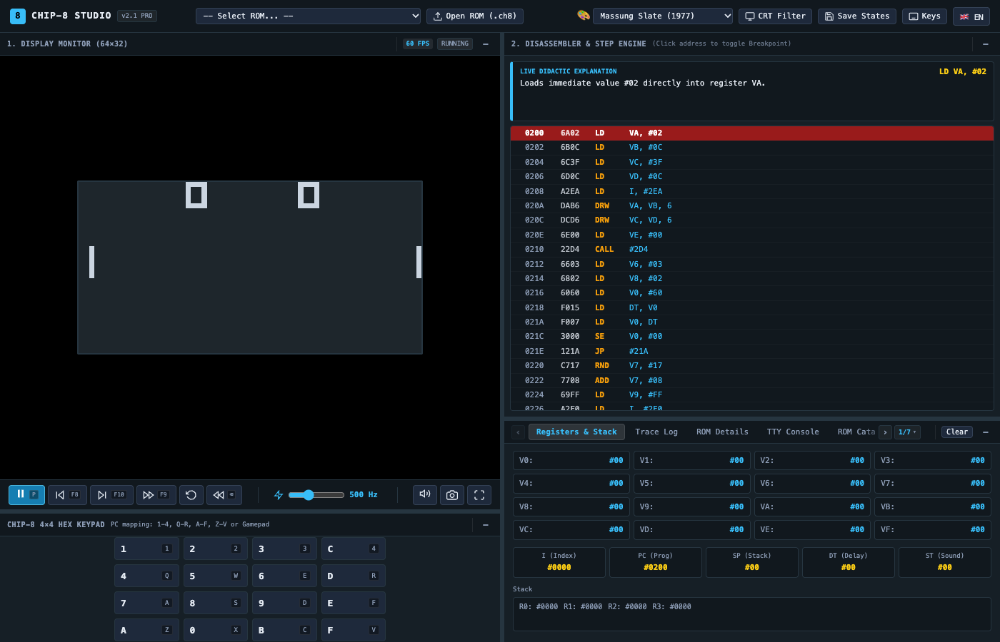
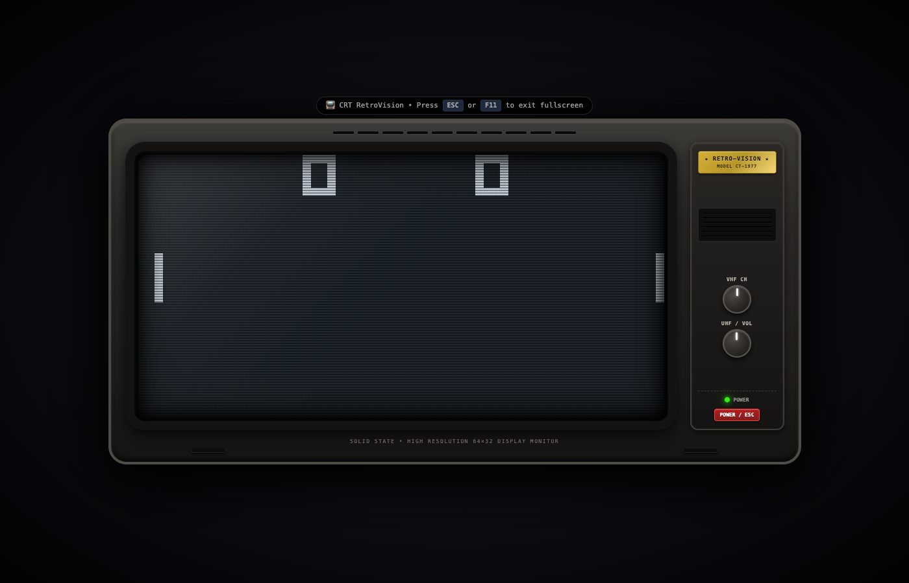
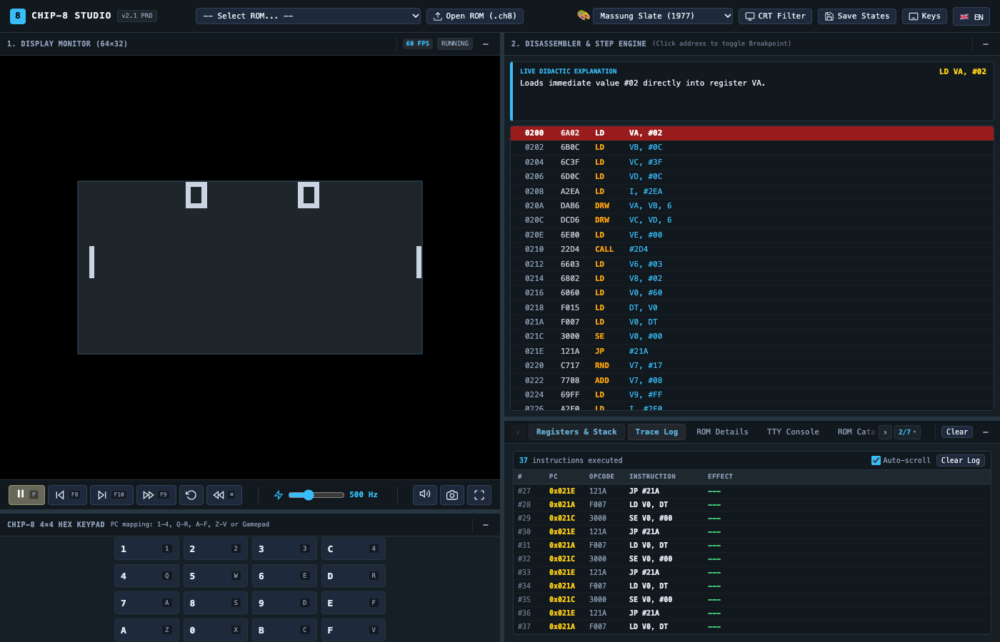
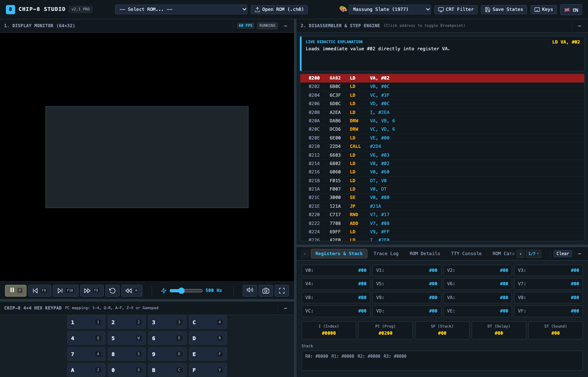

# 🕹️ CHIP-8 Studio & Debugger Workstation

<p align="center">
  <a href="README.md">English</a> | <strong>Español</strong>
</p>

<p align="center">
  <a href="https://github.com/jgestal/CHIP-8-Studio-Debugger"></a>
  <a href="https://github.com/jgestal/CHIP-8-Studio-Debugger"></a>
  <a href="https://github.com/jgestal/CHIP-8-Studio-Debugger"></a>
  <a href="https://github.com/jgestal/CHIP-8-Studio-Debugger"></a>
  <a href="https://github.com/jgestal/CHIP-8-Studio-Debugger"></a>
  <a href="LICENSE"></a>
</p>

<p align="center">
  Una <strong>Máquina Virtual y Estación de Depuración interactiva para CHIP-8</strong> de última generación desarrollada en <strong>Vanilla JavaScript (Módulos ES6)</strong>, HTML5 Canvas y CSS3 moderno. Diseñada bajo principios de <strong>Clean Code</strong> y <strong>Clean Architecture</strong>, con <strong>cero dependencias externas en tiempo de ejecución</strong>.
</p>

<p align="center">
  
</p>

---

## 🌟 Características Destacadas

- **Arquitectura Pura y Cero Dependencias**: 100% tecnologías web estándar (HTML5, CSS3, ES6 Modules, Web Audio API). Sin instalación de paquetes npm, sin Webpack, sin Vite y sin frameworks UI.
- **Viaje en el Tiempo (Time-Travel Debugging)**:
  - **Rebobinado Continuo**: Mantén presionado <kbd>Retroceso</kbd> o <kbd>Tab</kbd> durante el juego para retroceder fluidamente cientos de fotogramas en el tiempo.
  - **Paso Atrás por Instrucción (<kbd>F8</kbd>)**: Retrocede con precisión quirúrgica una única instrucción CPU a la vez para examinar estados previos de registros y bifurcaciones.
- **Desensamblador Didáctico en Vivo**: Decodificación de mnemónicos en tiempo real con explicaciones en lenguaje natural que explican el *porqué* de cada instrucción y etiquetan los registros modificados.
- **Experiencia Inmersiva en TV CRT Vintage**: Modo pantalla completa centrado con marco de televisor de tubo de los años 70/80 (chasis biselado, reflejos de cristal curvo, scanlines, diales giratorios y LED de encendido).
- **Panel Inspector con 7 Herramientas Integradas**:
  1. 📊 **Registros & Pila**: Registros de propósito general V0-VF con destello ante cambios, PC, I, SP, DT, ST y previsualización de los 16 niveles de pila.
  2. 📜 **Historial de Ejecución**: Registro cronológico de instrucciones con modo de congelación estable y control de auto-scroll.
  3. ℹ️ **Ficha de la ROM**: Metadatos técnicos, autor, año, controles sugeridos y descripción.
  4. 💻 **Consola TTY**: Terminal de texto para mensajes de sistema y telemetría de depuración.
  5. 🎮 **Catálogo de ROMs**: Colección categorizada de juegos, demos gráficas, tests y programas con soporte para arrastrar y soltar (.ch8).
  6. 🗺️ **Mapa de Memoria RAM (4KB)**: Mapa visual interactivo de los 4096 bytes con inspección de direcciones al pasar el cursor.
  7. 👾 **Visor de Sprites y Osciloscopio**: Renderizador en tiempo real del sprite monocromo apuntado por `I` y osciloscopio del sintetizador de audio.
- **Motor de Tooltips Flotantes Inteligentes**: Sistema que evita cualquier corte por los bordes de la pantalla o marcos con `overflow: hidden`, calculando la posición dinámicamente.
- **6 Temáticas Retro Seleccionables**: Jeffrey Massung Slate, NES Clásica (1983), Super Nintendo (1990), Terminal Verde VT220, Fósforo Ámbar y Game Boy DMG-01.
- **Controles sin Colisiones**: Las teclas esenciales de juego (<kbd>R</kbd>, <kbd>S</kbd>, <kbd>F</kbd>, <kbd>Espacio</kbd>) están 100% reservadas para la partida sin interferir con atajos de depuración.

---

## 📺 Galería Visual

### Modo Pantalla Completa TV CRT
Entra en pantalla completa (<kbd>F11</kbd>) para disfrutar de una auténtica televisión de tubo centrada con mandos físicos simulados:

<p align="center">
  
</p>

### Panel Inspector con Navegación y Selector de Pestañas
Cambia rápidamente entre las 7 herramientas diagnósticas con las flechas (`‹` / `›`) o el menú desplegable `1/7 ▾`:

<p align="center">
  
</p>

### Desensamblador y Explicador en Vivo
Examina paso a paso cada instrucción con explicaciones comprensibles y visualización de cambios en registros:

<p align="center">
  
</p>

### 6 Temáticas Retro Dinámicas
Cambia de estética en tiempo real con un solo clic:

<p align="center">
  
</p>

---

## 🕹️ Controles y Atajos de Teclado

### Teclado Hexadecimal CHIP-8 (COSMAC VIP 4×4 ↔ Teclado PC)

| Tecla Hex CHIP-8 | Tecla en Teclado PC | Tecla Hex CHIP-8 | Tecla en Teclado PC |
| :--------------: | :-----------------: | :--------------: | :-----------------: |
| **`1`** | `1` | **`C`** | `4` |
| **`2`** | `2` | **`D`** | `R` |
| **`3`** | `3` | **`E`** | `F` |
| **`4`** | `Q` | **`A`** | `Z` |
| **`5`** | `W` (o `Espacio`) | **`0`** | `X` |
| **`6`** | `E` | **`B`** | `C` |
| **`7`** | `A` | **`F`** | `V` |
| **`8`** | `S` | **`9`** | `D` |

### Atajos de la Estación de Trabajo

| Acción | Atajo Primario | Alternativa |
| :----- | :------------: | :---------: |
| **Reanudar / Pausar** | <kbd>P</kbd> | <kbd>Escape</kbd> |
| **Retroceder 1 Instrucción** | <kbd>F8</kbd> | <kbd>Shift</kbd> + <kbd>F10</kbd> |
| **Avanzar 1 Instrucción** | <kbd>F10</kbd> | — |
| **Avanzar 1 Fotograma (1/60s)** | <kbd>F9</kbd> | — |
| **Rebobinar Continuamente** (Mantener) | <kbd>Retroceso</kbd> | <kbd>Tab</kbd> |
| **Reiniciar Máquina Virtual** | <kbd>Alt</kbd> + <kbd>R</kbd> | — |
| **Pantalla Completa (TV CRT)** | <kbd>F11</kbd> | <kbd>Alt</kbd> + <kbd>Enter</kbd> |
| **Guardado Rápido (Quick Save)** | <kbd>F1</kbd> | <kbd>Alt</kbd> + <kbd>S</kbd> |
| **Carga Rápida (Quick Load)** | <kbd>F5</kbd> | <kbd>Alt</kbd> + <kbd>L</kbd> |
| **Capturar Pantalla (PNG)** | <kbd>F12</kbd> | — |
| **Ayuda de Controles y Atajos** | <kbd>?</kbd> | Botón en Barra Superior |

---

## 🏛️ Arquitectura Modular y Código Limpio

La estructura del proyecto mantiene una estricta separación de responsabilidades:

```
CHIP-8-Studio-Debugger/
├── index.html              # Estructura HTML5 semántica y paneles redimensionables
├── css/
│   └── styles.css          # Estilos CSS3, temáticas, shaders CRT y tooltips inteligentes
├── js/
│   ├── chip8.js            # Núcleo puro de la VM: CPU, registros, memoria y ejecución
│   ├── disassembler.js     # Decodificador de mnemónicos y explicador en lenguaje natural
│   ├── time-travel.js      # Motor de snapshots circulares (rebobinado y paso atrás)
│   ├── audio.js            # Sintetizador Web Audio API de onda cuadrada y osciloscopio
│   ├── keypad.js           # Gestor de teclado hexadecimal de 16 teclas y mapeo PC
│   ├── themes.js           # 6 perfiles temáticos y aplicación dinámica de tokens CSS
│   ├── i18n.js             # Diccionario bilingüe (EN/ES) y traductor reactivo del DOM
│   ├── ui.js               # Controlador de interfaz, redimensionadores y eventos
│   └── app.js              # Orquestador principal, bucle de ejecución y carga de ROMs
├── roms/
│   ├── games/              # ROMs clásicas: Space Invaders, Pong, Tetris, Pacman, etc.
│   ├── demos/              # Demos visuales: Stars, Sierpinski, Maze, etc.
│   ├── programs/           # Programas: Clock, Keypad Test, Life, etc.
│   └── manifest.json       # Catálogo estructurado de metadatos de las ROMs
├── docs/
│   └── assets/             # Capturas de alta definición para documentación
└── tests/
    ├── chip8.test.js       # Suite de tests unitarios de opcodes y límites de hardware
    ├── disassembler.test.js# Verificación de precisión del desensamblador
    ├── shortcuts.test.js   # Auditoría de colisión de teclas y separación de capas
    ├── themes.test.js      # Comprobación de tokens válidos en todos los temas
    └── trace.test.js       # Test de registro de traza y buffers circulares
```

---

## 🚀 Inicio Rápido

Al estar desarrollado con módulos nativos ES6 sin empaquetadores, puedes ejecutarlo con cualquier servidor web estático local:

### Opción 1: Python 3
```bash
python3 -m http.server 8080
```
Abre en tu navegador [http://localhost:8080](http://localhost:8080).

### Opción 2: Node.js (npx)
```bash
npx serve .
```

### Opción 3: Extensión Live Server de VS Code
Haz clic derecho en `index.html` y selecciona **"Open with Live Server"**.

---

## 🧪 Ejecución de Tests Automatizados

Ejecuta el corredor de pruebas nativo de Node.js (sin instalar frameworks de testing pesados):

```bash
node --test tests/*.test.js
```

Los 24 tests unitarios verifican:
- Fontset y estructura de memoria (0x000 - 0x1FF y punto de entrada 0x200).
- Operaciones aritméticas, lógicas, desplazamientos y flags de acarreo/préstamo (`VF`).
- Saltos a subrutinas, retornos y protección contra desbordamiento de pila (Overflow/Underflow).
- Renderizado XOR de sprites y detección de colisiones.
- Serialización y deserialización de Save States.
- Matriz de atajos de teclado con 0 colisiones.
- Integridad de tokens en todas las temáticas.

---

## 📄 Licencia

Este proyecto está bajo la **Licencia MIT** - consulta el archivo [LICENSE](LICENSE) para más detalles.
