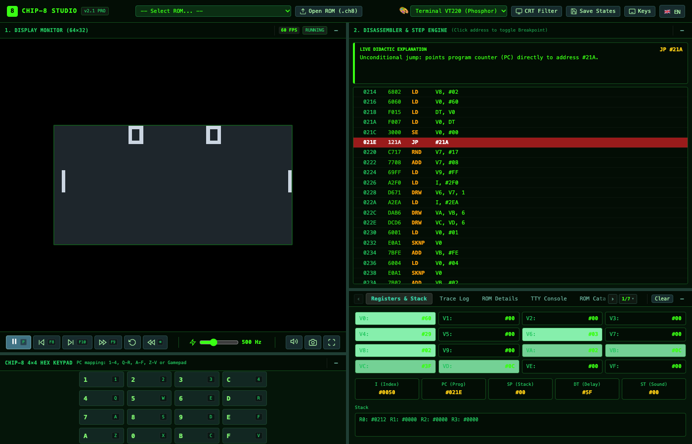
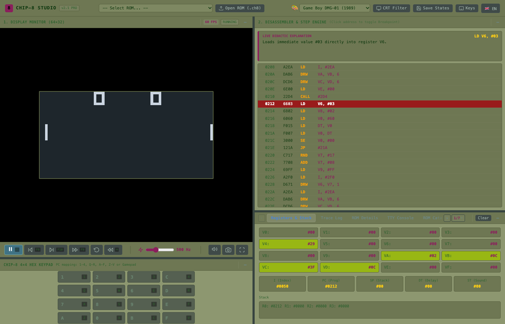
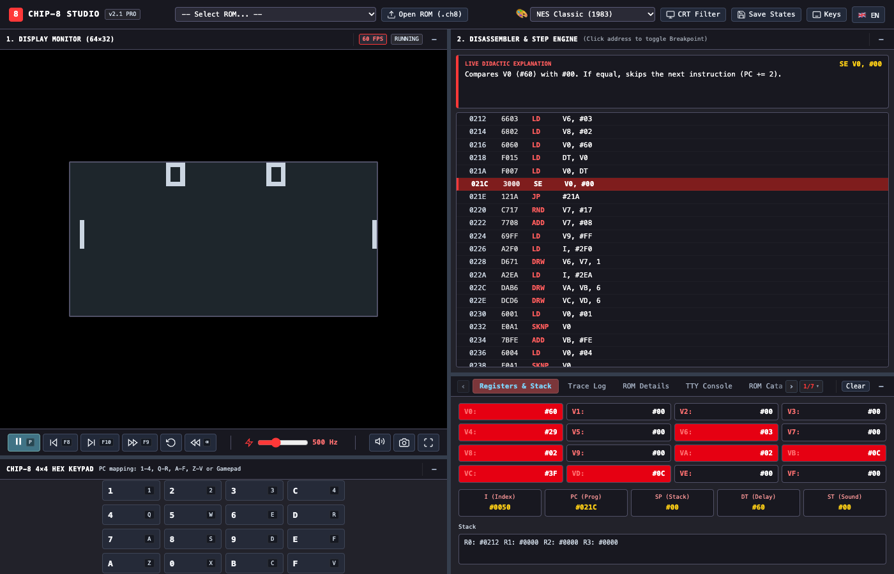
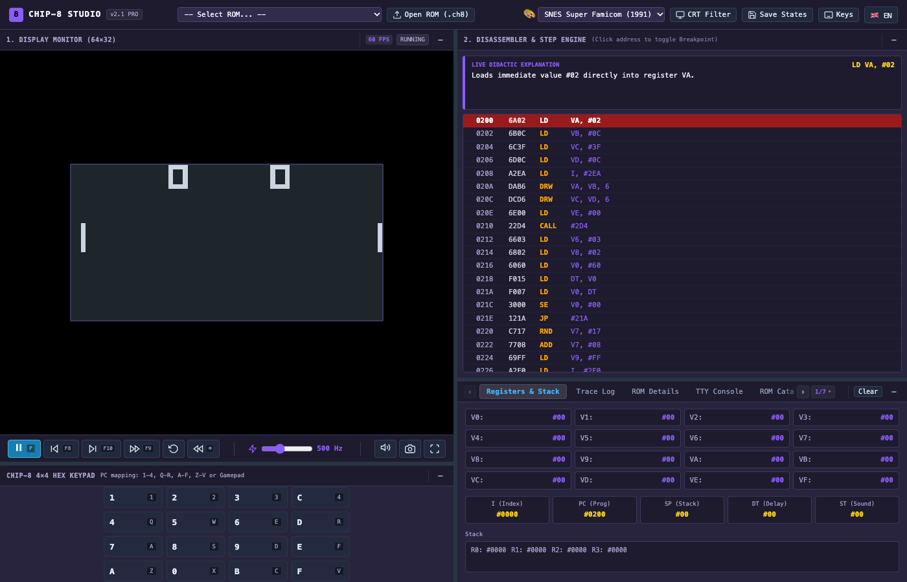
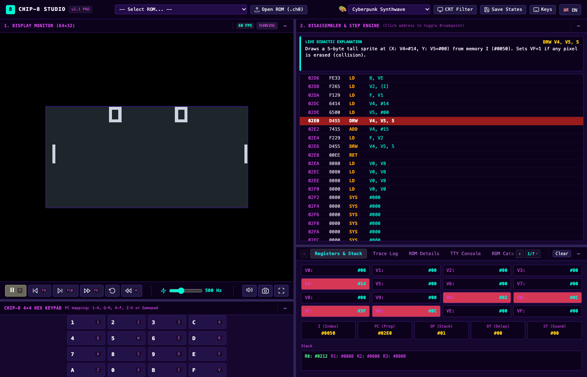
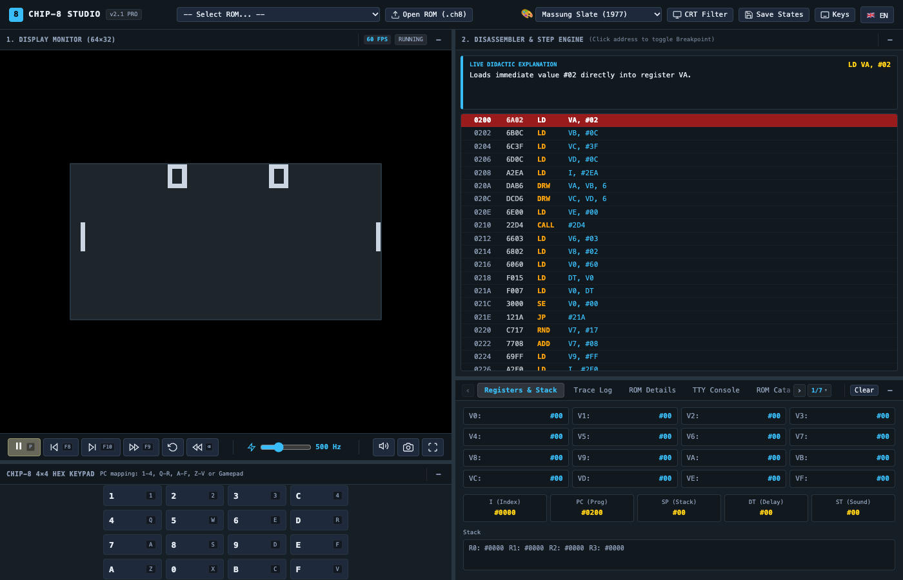

# 🕹️ CHIP-8 Studio & Debugger Workstation

<p align="center">
  <strong>English</strong> | <a href="README.es.md">Español</a>
</p>

<p align="center">
  <a href="https://github.com/jgestal/CHIP-8-Studio-Debugger"></a>
  <a href="https://github.com/jgestal/CHIP-8-Studio-Debugger"></a>
  <a href="https://github.com/jgestal/CHIP-8-Studio-Debugger"></a>
  <a href="https://github.com/jgestal/CHIP-8-Studio-Debugger"></a>
  <a href="https://github.com/jgestal/CHIP-8-Studio-Debugger"></a>
  <a href="LICENSE"></a>
</p>

<p align="center">
  An ultra-clean, state-of-the-art <strong>CHIP-8 Virtual Machine & Interactive Debugging Workstation</strong> built with pure <strong>Vanilla JavaScript (ES6 Modules)</strong>, HTML5 Canvas, and modern CSS3. Designed with <strong>Clean Code</strong> and <strong>Clean Architecture</strong> principles, featuring <strong>zero external runtime dependencies</strong>.
</p>

<p align="center">
  
</p>

---

## 🌟 Key Highlights

- **Pure Architecture & Zero Dependencies**: 100% standard web technologies (HTML5, CSS3, ES6 Modules, Web Audio API). No npm installs, webpack, vite, or external frameworks needed.
- **Time-Travel Debugging**:
  - **Continuous Rewind**: Hold <kbd>Backspace</kbd> or <kbd>Tab</kbd> during gameplay to smoothly rewind time up to hundreds of frames back.
  - **Single-Instruction Step-Back (<kbd>F8</kbd>)**: Step backward precisely one CPU opcode at a time to inspect previous register states and branching decisions.
- **Live Didactic Disassembler**: Real-time opcode decoding accompanied by natural-language explanations explaining *why* the CPU is executing each operation and highlighting register value changes.
- **Immersive Retro CRT Fullscreen**: A vintage 1970s curved television chassis complete with beveled bezels, phosphor glass reflections, scanlines, knurled rotary knobs, and illuminated status indicators.
- **Hardware Inspector with 7 Interactive Tools**:
  1. 📊 **Registers & Stack**: Live general-purpose registers V0-VF with delta pulsing, plus PC, I, SP, DT, ST, and 16-level call stack preview.
  2. 📜 **Trace Log**: Detailed chronological execution log with opcode mnemonic decoding, freeze-inspection mode, and auto-scroll control.
  3. ℹ️ **ROM Details**: Comprehensive technical metadata, release year, recommended controls, and synopsis.
  4. 💻 **TTY Console**: Standard output stream for system messages and developer telemetry.
  5. 🎮 **ROM Catalog**: Categorized library of built-in games, graphics demos, tests, and utility programs with drag-and-drop support.
  6. 🗺️ **RAM Heatmap (4KB)**: Interactive memory visualizer showing interpreter reserved regions, fontset, and live program space with mouseover address inspection.
  7. 👾 **Sprite Viewer & Audio Oscilloscope**: Real-time 8-pixel sprite visualizer for pattern address `I` and Web Audio square-wave oscilloscope.
- **Smart Floating Tooltips Engine**: Zero-clipping floating tooltip overlay mounted directly on `document.body` that automatically clamps within viewport boundaries and flips below elements near the screen edge.
- **6 Curated Retro Themes**: Jeffrey Massung Slate, NES Classic (1983), Super Nintendo (1990), Terminal Green VT220, Amber CRT, and Game Boy DMG-01.
- **Zero-Collision Controls**: Essential gameplay keys (<kbd>R</kbd>, <kbd>S</kbd>, <kbd>F</kbd>, <kbd>Space</kbd>) are 100% reserved for virtual machine execution without conflict.

---

## 📺 Visual Showcase

### Retro CRT TV Fullscreen Mode
Enter fullscreen (<kbd>F11</kbd>) to center the display inside a curved, 1970s wood-and-gold cathode-ray tube television:

<p align="center">
  
</p>

### Hardware Inspector with Tab Navigation & Tool Selector
Easily switch between all 7 diagnostic tools using the navigation arrows (`‹` / `›`) or the `1/7 ▾` quick menu:

<p align="center">
  
</p>

### Real-Time Disassembler & Explainer
Inspect executed instructions step-by-step with plain-English descriptions and register diff tags:

<p align="center">
  
</p>

### 6 Curated Retro Color Themes
Switch visual aesthetics instantly in real time without restarting your game or losing machine state:

| **Terminal Green (VT220 Phosphor)** | **Game Boy (DMG-01 1989)** |
|:---:|:---:|
| [](docs/assets/theme-terminal.png) | [](docs/assets/theme-gameboy.png) |
| **NES Classic (1983 Nintendo)** | **SNES Super Famicom (1990)** |
| [](docs/assets/theme-nes.png) | [](docs/assets/theme-snes.png) |
| **Cyberpunk (Outrun Synthwave)** | **Jeffrey Massung Slate (1977)** |
| [](docs/assets/theme-cyberpunk.png) | [](docs/assets/theme-massung.png) |

---

## 🕹️ Keyboard Controls & Shortcuts

### CHIP-8 Keypad (COSMAC VIP 4×4 ↔ PC Keyboard)

| CHIP-8 Hex Key | PC Keyboard Key | CHIP-8 Hex Key | PC Keyboard Key |
| :------------: | :-------------: | :------------: | :-------------: |
| **`1`** | `1` | **`C`** | `4` |
| **`2`** | `2` | **`D`** | `R` |
| **`3`** | `3` | **`E`** | `F` |
| **`4`** | `Q` | **`A`** | `Z` |
| **`5`** | `W` (or `Space`) | **`0`** | `X` |
| **`6`** | `E` | **`B`** | `C` |
| **`7`** | `A` | **`F`** | `V` |
| **`8`** | `S` | **`9`** | `D` |

### Workstation Hotkeys

| Action | Primary Shortcut | Alternative |
| :----- | :--------------: | :---------: |
| **Play / Pause** | <kbd>P</kbd> | <kbd>Escape</kbd> |
| **Step Back 1 Instruction** | <kbd>F8</kbd> | <kbd>Shift</kbd> + <kbd>F10</kbd> |
| **Step Forward 1 Instruction** | <kbd>F10</kbd> | — |
| **Step Forward 1 Frame (1/60s)** | <kbd>F9</kbd> | — |
| **Continuous Rewind** (Hold) | <kbd>Backspace</kbd> | <kbd>Tab</kbd> |
| **Reset Virtual Machine** | <kbd>Alt</kbd> + <kbd>R</kbd> | — |
| **Fullscreen Mode (CRT TV)** | <kbd>F11</kbd> | <kbd>Alt</kbd> + <kbd>Enter</kbd> |
| **Quick Save State** | <kbd>F1</kbd> | <kbd>Alt</kbd> + <kbd>S</kbd> |
| **Quick Load State** | <kbd>F5</kbd> | <kbd>Alt</kbd> + <kbd>L</kbd> |
| **Take Screenshot (PNG)** | <kbd>F12</kbd> | — |
| **Keyboard Shortcuts Modal** | <kbd>?</kbd> | Toolbar Button |

---

## 🏛️ Architecture & Clean Code

The application follows strict modular decoupling with separation of concerns:

```
CHIP-8-Studio-Debugger/
├── index.html              # Semantic HTML5 layout with resizable workstation panels
├── css/
│   └── styles.css          # CSS3 with themes, responsive layout, CRT shaders & smart tooltips
├── js/
│   ├── chip8.js            # Pure Virtual Machine core: CPU, registers, memory, opcode decoding
│   ├── disassembler.js     # Opcode decoder with natural-language didactical explanations
│   ├── time-travel.js      # Circular buffer snapshot engine (rewind & instruction step-back)
│   ├── audio.js            # Web Audio API square-wave synthesizer & oscilloscope
│   ├── keypad.js           # 16-key hex keypad state manager & default key mappings
│   ├── themes.js           # 6 CSS theme profiles with dynamic token application
│   ├── i18n.js             # Bilingual dictionary (English / Spanish) & DOM reactive translator
│   ├── ui.js               # UI controller, floating tooltips, panel resizers, and event glue
│   └── app.js              # Application orchestrator, game loop (requestAnimationFrame), and ROM loader
├── roms/
│   ├── games/              # Classic ROMs: Space Invaders, Pong, Tetris, Pacman, etc.
│   ├── demos/              # Graphic & audio demos: Stars, Sierpinski, Maze, etc.
│   ├── programs/           # Clock, Keypad Test, Life, etc.
│   └── manifest.json       # Structured ROM catalog metadata
├── docs/
│   └── assets/             # High-resolution screenshots and showcase images
└── tests/
    ├── chip8.test.js       # Complete unit test suite for CPU opcodes & edge cases
    ├── disassembler.test.js# Validation for disassembler accuracy
    ├── shortcuts.test.js   # Automated collision & separation audit for all keyboard keys
    ├── themes.test.js      # Verification of all 6 theme CSS tokens
    └── trace.test.js       # Trace log & circular buffer limit testing
```

---

## 🚀 Getting Started

Since this project uses native ES6 modules without compilation or build steps, run it using any local static web server:

### Option 1: Python 3
```bash
python3 -m http.server 8080
```
Open [http://localhost:8080](http://localhost:8080) in your browser.

### Option 2: Node.js (npx)
```bash
npx serve .
```

### Option 3: VS Code Live Server
Right-click on `index.html` and select **"Open with Live Server"**.

---

## 🧪 Running Automated Tests

Run the built-in Node.js native test runner (zero external testing libraries required):

```bash
node --test tests/*.test.js
```

All 24 test suites validate:
- Fontset & memory layout (0x000 - 0x1FF and 0x200 start)
- Arithmetic, bitwise shifts, and carry/borrow flags (`VF`)
- Subroutine jumps, returns, and stack overflow/underflow safeguards
- XOR sprite blitting and collision detection
- Save state serialization and deserialization
- Keyboard shortcuts zero-collision matrix
- Theme registry token completeness

---

## 📄 License

This project is licensed under the **MIT License** - see the [LICENSE](LICENSE) file for details.
